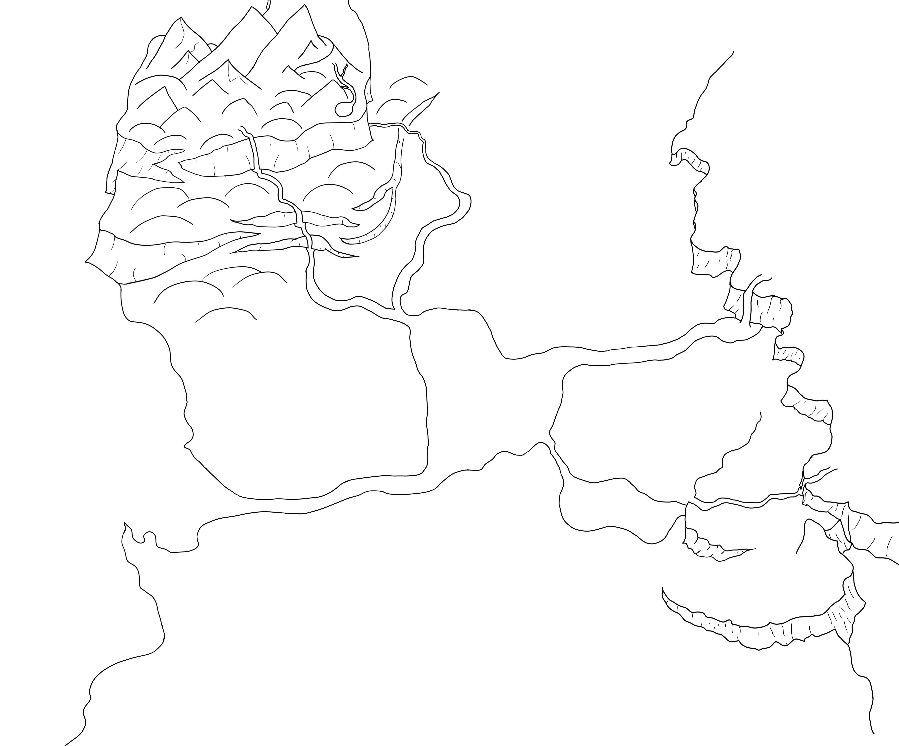

  🌐 <b>Select language / Choisir la langue :</b> 
  <a href="#lang-en"><b>🇬🇧 English</b></a> • <a href="#lang-fr"><b>🇫🇷 Français</b></a>

# Lagrandia

# 🇬🇧 English

# About The Project
Lagrandia is an ambitious **3D open-world life simulation game currently in active development**. Inspired by titles such as *The Legend of Zelda: Breath of the Wild*, *Fantasy Life*, and *Valheim*, the core of our game revolves around **exploring a rich open world**, a **complex profession system** that shapes how you fight and gather resources, and **rebuilding your village**, seamlessly integrating your relationships with its inhabitants into your adventure.

A more detailed breakdown of the profession system is available in the [`jobs.md`](./jobs.md) file.

* **Game Engine:** Godot Engine 
* **Language(s):** GDScript / C#
* **Start Date:** July 2026

### World Map Preview

Below is an early, unlabeled preview of the world map of **Lagrandia**:

Made by Bastien Brogliato--Martin.

## Project Team

- **Project Coordinator:**
Bastien Brogliato--Martin

- **Developers:**
Nils Desbois-Renaudin
Anne Regennass

- **Concept Artists & Graphic Designers:**
Anthony Ruberti
Garance Baylac

- **Writers / Narrative Designers:**
Matthieu Lejosne

- **Composers & Musicians:**
Gael Constant
Tom Loisil

## ⚠️ Notice Regarding Repository Content:

To protect our original creations, game design, and intellectual property from automated scraping and AI training tools, this repository intentionally contains very limited information.

  <a href="#top">⬆️ <b>Back to top</b></a>

----

# 🇫🇷 Français

# Descritpion du projet

**Lagrandia** est un projet ambitieux de jeu de simulation de vie en **monde ouvert 3D, actuellement en cours de développement**. Inspiré d'entre autres *The Legend of Zelda: Breath of the wild*, *Fantasy Life* et *Valheim*, le coeur de notre jeu tourne autour de **l'exploration d'un monde riche**, d'un **système de métier** complexe, influençant votre manière de combattre et de récolter des ressources, et de la **reconstruction de votre village**, en entretenant des relations riches avec ses habitants.

Vous trouverez une description plus détaillée du système de métiers dans le fichier [`jobs.md`](./jobs.md).

* **Moteur de jeu :** Godot Engine 
* **Langage(s) :** GDScript / C#
* **Date de début :** Juillet 2026

### Aperçu de la carte du monde

Voici une première version (non légendée) de la carte du monde de **Lagrandia** :

Réalisée par Bastien Brogliato--Martin.

## Equipe de Projet

- **Coordinateur de projet :**
Bastien Brogliato--Martin

- **Developpeurs :**
Nils Desbois-Renaudin
Anne Regennass

- **Concept artistes et graphistes :**
Anthony Ruberti
Garance Baylac

- **Scénaristes :** 
Matthieu Lejosne

- **Compositeurs des musiques et musiciens :**
Gael Constant
Tom Loisil

## ⚠️ Note concernant le contenu du dépôt :

Afin de protéger nos créations originales, notre game design et notre propriété intellectuelle contre la récupération automatisée et l'entraînement d'IA, ce dépôt contient volontairement très peu d'informations.

  <a href="#top">⬆️ <b>Retour en haut</b></a>

 
